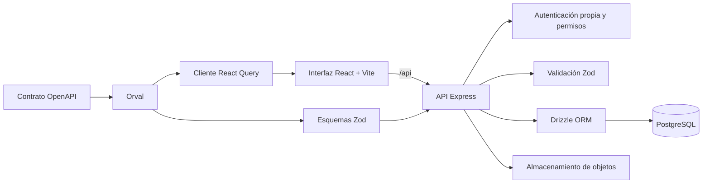

# RED FP360

**RED FP360** es un ERP educativo para practicar la gestión de empresas ficticias y la coordinación entre centros de formación. Sus operaciones, documentos, cálculos fiscales y movimientos financieros pertenecen a una simulación didáctica: la aplicación no sustituye a un ERP comercial ni ejecuta trámites o pagos reales.

El proyecto se desarrolla como un monorepo PNPM con una interfaz web, una API Express, un esquema PostgreSQL y contratos OpenAPI que generan validadores y clientes TypeScript.

> **Importante:** las previsiones, facturas, asientos, formularios tributarios, nóminas, movimientos bancarios y datos laborales son simulados. No se presentan declaraciones, no se envían pagos y no se realizan operaciones bancarias o administrativas reales.

## Contenido

- [Alcance funcional](#alcance-funcional)
- [Arquitectura](#arquitectura)
- [Estructura del repositorio](#estructura-del-repositorio)
- [Requisitos](#requisitos)
- [Ejecución en Replit](#ejecución-en-replit)
- [Ejecución local](#ejecución-local)
- [Instalación en Ubuntu desde GitHub](#instalación-en-ubuntu-desde-github)
- [Configuración y secretos](#configuración-y-secretos)
- [Autenticación y permisos](#autenticación-y-permisos)
- [Datos y persistencia](#datos-y-persistencia)
- [API y generación de código](#api-y-generación-de-código)
- [Pruebas y validaciones](#pruebas-y-validaciones)
- [Cambios de esquema de base de datos](#cambios-de-esquema-de-base-de-datos)
- [Archivos y almacenamiento de objetos](#archivos-y-almacenamiento-de-objetos)
- [Seguridad y límites de uso](#seguridad-y-límites-de-uso)
- [Resolución de problemas](#resolución-de-problemas)

## Alcance funcional

La navegación de la aplicación organiza las capacidades de RED FP360 en módulos como:

- **Dirección y red:** inicio y cuadro de mando, Mercado FP360, coordinación intercentros y administración.
- **Actividad comercial:** ventas, compras, catálogo, almacén, logística, facturas, clientes y CRM.
- **Gestión financiera:** contabilidad, tesorería, Banco FP360 y Hacienda FP360.
- **Personas y aprendizaje:** recursos humanos, empleo, nóminas, Seguridad Social, evaluación docente, mentoría, portafolio profesional y simulaciones formativas.
- **Operación y soporte:** atención al cliente, proyectos y servicios, comunicaciones y gestión documental.

La pantalla **Aplicaciones** presenta el catálogo del producto. Que una capacidad aparezca en el catálogo o tenga una pantalla no significa que esté lista para producción; el grado de implementación debe comprobarse en su interfaz, API y pruebas.

### Límites didácticos por área

- **Contabilidad:** los borradores no afectan a los saldos. Solo los asientos contabilizados y equilibrados cambian los saldos del mayor. Las correcciones se registran mediante contrasientos vinculados; no se sobrescriben asientos contabilizados. El cierre anual muestra controles y saldos, pero no genera automáticamente un asiento de regularización.
- **Hacienda:** AEAT y Agencia Tributaria Canaria (ATC) son apartados separados. Los modelos y plantillas oficiales se usan como referencias educativas versionadas; la aplicación no presenta declaraciones ni certifica su validez legal. La aplicabilidad depende del perfil fiscal simulado.
- **Banco y tesorería:** movimientos, conciliaciones, financiación y previsiones son ejercicios; no se conectan a cuentas bancarias reales ni ordenan pagos.
- **Recursos humanos, nóminas y Seguridad Social:** los expedientes y cálculos son de práctica. No se envían contratos, nóminas, retenciones ni cotizaciones.
- **Comunicaciones y CRM:** las comunicaciones se registran dentro de la simulación; no se envían mensajes a personas reales.
- **Documentación:** los documentos pertenecen a empresas y expedientes simulados, con control de versiones y trazabilidad.

## Arquitectura



- **Interfaz:** React, TypeScript, Vite, Wouter y TanStack Query.
- **API:** Node.js y Express 5; valida las entradas y aplica autenticación y alcance por empresa en el servidor.
- **Persistencia:** PostgreSQL y Drizzle ORM.
- **Contrato:** `lib/api-spec/openapi.yaml` es la fuente del contrato HTTP. Orval genera el cliente de React Query y los esquemas Zod.
- **Archivos:** el servicio de almacenamiento de objetos conserva los archivos; PostgreSQL almacena sus metadatos y relaciones con empresas y expedientes.

## Estructura del repositorio

```text
.
├── artifacts/
│   ├── red-fp360/          # Aplicación web RED FP360
│   ├── api-server/         # API Express y rutas de negocio
│   └── mockup-sandbox/     # Servidor de previsualización de componentes
├── lib/
│   ├── api-spec/           # Contrato OpenAPI y configuración de Orval
│   ├── api-client-react/   # Cliente React Query generado
│   ├── api-zod/            # Validadores Zod generados
│   └── db/                 # Conexión, esquemas Drizzle y pruebas de datos
├── scripts/                # Scripts auxiliares y configuración del workspace
├── docs/                   # Documentación complementaria del proyecto
├── generated-artifacts/    # Resultados generados; no deben tratarse como fuente
├── package.json            # Comandos del workspace
└── pnpm-workspace.yaml     # Paquetes y versiones compartidas
```

La API organiza las funciones en rutas separadas para autenticación, administración, catálogo, compras, logística, contabilidad, banco, fiscalidad, nóminas, documentación, coordinación y otros módulos. El registro central de rutas está en `artifacts/api-server/src/routes/index.ts`.

## Requisitos

- Node.js 24 (la configuración de Replit declara el módulo `nodejs-24`).
- PNPM. El `preinstall` del workspace rechaza otros gestores.
- PostgreSQL accesible mediante `DATABASE_URL`.
- Secretos configurados en el gestor de secretos de Replit o en el gestor seguro del entorno de desarrollo.

Instalación de dependencias:

```bash
pnpm install --frozen-lockfile
```

No cambies `pnpm-lock.yaml` manualmente. Después de modificar dependencias, utiliza PNPM y conserva el lockfile actualizado.

## Ejecución en Replit

El proyecto dispone de workflows separados:

| Workflow | Comando |
|---|---|
| API Server | `pnpm --filter @workspace/api-server run dev` |
| RED FP360 web | `pnpm --filter @workspace/red-fp360 run dev` |
| Component Preview Server | `pnpm --filter @workspace/mockup-sandbox run dev` |

Inicia el workflow **Project** desde Replit para levantar los servicios configurados. La plataforma proporciona los puertos y la ruta base que requieren Vite y la API. No publiques los valores de entorno inyectados por la plataforma.

## Ejecución local

1. Instala las dependencias con PNPM.
2. Configura `DATABASE_URL` y `SESSION_SECRET` en el entorno. Para la primera configuración, añade también `RED_FP360_SETUP_TOKEN`.
3. Inicia API y web en terminales separadas:

```bash
# Terminal 1: API; PORT es obligatorio
PORT=8080 pnpm --filter @workspace/api-server run dev

# Terminal 2: interfaz servida desde la raíz local
PORT=5173 BASE_PATH=/ pnpm --filter @workspace/red-fp360 run dev
```

La interfaz consume la API bajo `/api`. En un entorno fuera de Replit, configura el proxy o servidor web para que `/api` llegue a la API; no expongas la base de datos directamente al navegador. Si la web se sirve bajo una ruta distinta de `/`, usa esa ruta como `BASE_PATH` y configura el proxy con el mismo prefijo.

Comandos habituales:

```bash
# Comprobación de tipos del workspace
pnpm run typecheck

# Compilar y validar todos los paquetes
pnpm run build

# Compilar únicamente la interfaz web
PORT=5173 BASE_PATH=/ pnpm --filter @workspace/red-fp360 run build

# Regenerar cliente y validadores a partir de OpenAPI
pnpm --filter @workspace/api-spec run codegen
```

La API requiere `PORT` también al arrancar. Su workflow de desarrollo construye el servidor antes de iniciarlo.

## Instalación en Ubuntu desde GitHub

El instalador configura una **instalación nueva** en Ubuntu Server 22.04 o 24.04. Instala Node.js 24, PNPM 10.26.1, PostgreSQL 16 y Caddy; crea una base de datos local vacía, compila la aplicación, configura un servicio `systemd` y publica la web detrás de HTTPS. No sobrescribe una instalación ni una base con el mismo nombre.

La primera descarga no necesita `curl` ni `git` preinstalados: instala `git` desde APT, clona el repositorio y ejecuta el instalador desde ese checkout. No uses `curl | bash`; descarga y revisa el script antes de ejecutarlo:

```bash
sudo env DEBIAN_FRONTEND=noninteractive apt-get update
sudo env DEBIAN_FRONTEND=noninteractive apt-get install -y ca-certificates git
git clone --depth 1 --branch main https://github.com/atreyu1968/Fp360.git /tmp/redfp360-bootstrap
cat /tmp/redfp360-bootstrap/scripts/install-ubuntu.sh
sudo bash /tmp/redfp360-bootstrap/scripts/install-ubuntu.sh \
  --domain TU_DOMINIO
```

Sustituye `TU_DOMINIO` por un dominio DNS real que apunte a este servidor. El instalador no pregunta datos por consola: si falta una opción obligatoria, termina con un error. Para producción, fija un commit o tag concreto en lugar de instalar una rama que puede cambiar. Si el repositorio es privado, configura acceso SSH en el servidor y usa la URL SSH; no pongas tokens de GitHub en la URL, en el script ni en el historial de shell.

### Almacenamiento y red

- En Ubuntu, los documentos se guardan en el disco del servidor, dentro de `/var/lib/redfp360/objects`. El directorio privado no se publica directamente: las descargas pasan por la API y sus comprobaciones de acceso.
- El script `scripts/backup-ubuntu.sh` crea una copia cifrada única de PostgreSQL y `/var/lib/redfp360/objects`, deteniendo brevemente la API para coordinarlos. Ejecuta el ensayo de restauración con `restore-drill` antes de confiar en las copias. Consulta [el procedimiento de copias y recuperación en Ubuntu](docs/ubuntu-backups.md) para proteger la clave, elegir destino, definir retención y recuperar los datos. Replit conserva su almacenamiento administrado en sus propios despliegues.
- Configura el DNS del dominio hacia el servidor y permite tráfico entrante en los puertos 80 y 443. Caddy obtiene y renueva el certificado TLS. El instalador no cambia el firewall, no reinicia el servidor y no ejecuta una actualización general de Ubuntu.
- `--upgrade-system` actualiza los paquetes APT en modo no interactivo cuando se incluye expresamente. No cambia la versión de Ubuntu ni reinicia el servidor. El instalador se detiene en versiones distintas de 22.04 o 24.04; no ejecuta `do-release-upgrade`.

### Alta inicial y límites del instalador

El servicio API queda vinculado a `127.0.0.1:8080`; Caddy sirve la web y enruta `/api`. La base inicial se crea como una base nueva y aislada. El `push` de esquema solo se ejecuta contra esa base recién creada, nunca contra una base proporcionada por el usuario.

El token de alta inicial se guarda solo para root en `/root/redfp360-setup-token`. Léelo por consola segura para crear la cuenta administradora. Cuando termines, retira el token y reinicia el servicio:

```bash
sudo cat /root/redfp360-setup-token
sudo /opt/redfp360/scripts/finalize-ubuntu-setup.sh
```

La clave `GROQ_API_KEY` no se copia desde Replit ni se configura automáticamente. Si habilitas GroqCloud, introdúcela únicamente en el entorno seguro del servidor. La autonomía usa un solo proceso API en esta instalación.

El instalador programa una copia diaria, pero no monta el destino externo, crea la frase secreta ni abre puertos del firewall. Configura el destino externo y ensaya la restauración antes de admitir centros o datos de uso real. Para actualizar, usa `scripts/update-ubuntu.sh`; no vuelvas a ejecutar el instalador sobre una instalación existente.

### Actualizar una instalación existente

El actualizador no es interactivo y descarga la referencia indicada de GitHub. Valida la compilación, exige que el destino externo de copias esté montado y que exista el archivo de frase secreta, crea una copia cifrada antes de cambiar el código y comprueba la salud de la API. Si la API no arranca, intenta restaurar la versión anterior del código:

```bash
sudo /opt/redfp360/scripts/update-ubuntu.sh --ref main
```

No ejecuta `drizzle-kit push` ni modifica la base de datos. Si detecta cambios en el esquema, se detiene antes de la copia y del despliegue; esos cambios necesitan una migración de datos revisada. Conserva hasta dos directorios de código anteriores en `/opt/redfp360.rollback.*`. Las actualizaciones de paquetes del sistema son una opción separada del instalador (`--upgrade-system`).

El instalador programa copias diarias, pero no monta el destino externo ni crea la frase secreta. Antes de la primera copia correcta, configura ambos según [el procedimiento de copias y recuperación en Ubuntu](docs/ubuntu-backups.md). Si faltan al ejecutar el actualizador, este falla sin tocar la instalación.

## Configuración y secretos

Los valores secretos deben guardarse en Replit Secrets o en un gestor seguro equivalente. **No los incluyas en este README, en Git, en capturas ni en logs.**

| Variable | Uso |
|---|---|
| `DATABASE_URL` | Conexión PostgreSQL. Obligatoria para la API, el paquete de base de datos y las pruebas que usan datos. |
| `SESSION_SECRET` | Firma de sesiones y derivación de material criptográfico para la autenticación multifactor. Obligatoria para la autenticación. |
| `RED_FP360_SETUP_TOKEN` | Autoriza el endpoint de configuración inicial `/auth/setup`. No es una contraseña de uso diario; limita su exposición y guárdalo como secreto. |
| `PUBLIC_OBJECT_SEARCH_PATHS` | Rutas públicas separadas por comas para el servicio de almacenamiento de objetos, cuando se habiliten recursos públicos. |
| `PRIVATE_OBJECT_DIR` | Prefijo privado de Replit; en modo local se deriva de `LOCAL_OBJECT_STORAGE_DIR`. |
| `RED_FP360_STORAGE_BACKEND` | `replit` por defecto en Replit; `local` para almacenar los documentos en el disco privado del servidor Ubuntu. |
| `LOCAL_OBJECT_STORAGE_DIR` | Raíz del almacenamiento local de objetos; debe ser una ruta absoluta y escribible por el servicio API. |
| `PUBLIC_BASE_URL` | URL HTTPS pública del servidor; se usa para generar enlaces temporales de carga local. |
| `HOST` | Dirección de escucha del API. En instalación propia, `127.0.0.1` para que solo Caddy acceda al proceso. |
| `PORT` | Puerto del proceso API. Vite recibe el puerto de los workflows y usa valores propios para compilaciones fuera de Replit. |
| `BASE_PATH` | Prefijo de publicación de Vite. Replit lo establece en los workflows; las compilaciones usan `/` para la web y `/__mockup` para la sandbox si no se indica otro valor. |
| `NODE_ENV` | Distingue desarrollo y producción; en producción activa, entre otros controles, cookies seguras. |
| `LOG_LEVEL` | Nivel de logging del API; por defecto se utiliza `info`. |
| `API_BASE_URL` | Solo para pruebas de integración de `lib/db`; por defecto apunta a `http://127.0.0.1:8080/api`. |
| `DEFAULT_OBJECT_STORAGE_BUCKET_ID` | Identificador interno de App Storage administrado por Replit; no se necesita en Ubuntu. |

El endpoint de configuración inicial falla de forma cerrada si `RED_FP360_SETUP_TOKEN` no está configurado. No compartas su valor ni lo incluyas en una URL pública.

## Autenticación y permisos

- RED FP360 usa **autenticación propia de la aplicación**. No usa Clerk.
- El servidor gestiona el inicio y cierre de sesión, las sesiones y las rutas de MFA/TOTP.
- TOTP mantiene HMAC-SHA1 de RFC 4226/6238 para compatibilidad con autenticadores. El aviso estático sobre SHA-1 debe revisarse en ese contexto: no se usa SHA-1 para contraseñas ni para cifrar secretos; cambiar el algoritmo sin migrar los registros existentes rompería los códigos MFA.
- Las cookies de sesión son `HttpOnly` y `SameSite=Lax`; en producción se marcan como `Secure`.
- La API valida el rol y el alcance de organización/empresa en el servidor. Ocultar una opción en la interfaz no sustituye a la comprobación de permisos del API.
- Las invitaciones y los permisos administrativos tienen controles adicionales. Los enlaces de invitación deben compartirse por un canal seguro y no registrarse en logs.

## Datos y persistencia

- Los esquemas Drizzle están bajo `lib/db/src/schema/`; `lib/db/src/schema/index.ts` reúne los módulos.
- La conexión PostgreSQL se crea desde `lib/db/src/index.ts`.
- La mayoría de los datos de negocio están asociados a un tenant y a una organización. Las consultas y exportaciones deben aplicar el alcance autorizado del actor.
- Las transiciones sensibles conservan eventos o historial cuando el módulo los requiere.
- Las pruebas que modifican datos deben usar una base de desarrollo, datos temporales y limpieza en `finally`. No ejecutes pruebas de integración contra producción.

## API y generación de código

- La API está disponible bajo el prefijo `/api`; sus rutas de negocio se agrupan, por ejemplo, en `/redfp360/accounting`, `/redfp360/tax`, `/redfp360/documents` y `/auth`.
- El contrato OpenAPI está en `lib/api-spec/openapi.yaml`.
- El comando `pnpm --filter @workspace/api-spec run codegen` genera:
  - `lib/api-client-react/src/generated/`: cliente y hooks React Query.
  - `lib/api-zod/src/generated/`: tipos y esquemas de validación Zod.
- Edita primero el contrato OpenAPI cuando cambie la forma pública de una petición o respuesta. No edites manualmente los archivos generados: vuelve a ejecutar `codegen` y valida los paquetes.
- Las operaciones financieras y fiscales tienen alcance de simulación. Las API no son una pasarela para presentar declaraciones o enviar operaciones reales.

## Coordinador económico con IA local o GroqCloud

El coordinador crea propuestas didácticas de campañas y eventos para conectar el trabajo de varias empresas simuladas. Por defecto requiere aprobación humana. La administración puede delegar una empresa concreta para ejecutar únicamente las operaciones didácticas autorizadas abajo. No ejecuta pedidos, pagos, cambios de stock, asientos, declaraciones ni trámites reales.

### Delegar una empresa y recuperar su control

En **Administración → Integraciones → Autonomía simulada por empresa**, selecciona la empresa, marca los permisos y confirma la autorización explícita. No basta con elegir la modalidad autónoma de una campaña. La delegación requiere el proveedor local; GroqCloud sigue disponible para generar propuestas supervisadas, no para los ciclos autónomos.

- `create_simulated_document`: crea borradores de notas didácticas, sintéticos, privados para la empresa y descargables desde Documentación. Nunca confirma documentos automáticamente.
- `complete_simulation_event`: vincula un documento ficticio ya confirmado, visible en la empresa y del tipo exigido, y completa un evento publicado de una campaña activa. No actúa sobre eventos futuros, con precondiciones pendientes o con evidencia ya vinculada.
- Cada empresa tiene un identificador de servicio sin cuenta de acceso ni sesión. El servicio solo puede escribir mediante estas dos operaciones, dentro de su tenant y empresa. La IA consulta el estado y el historial de toda la red antes de cada ciclo, pero no recibe identidades ni contactos personales.
- El servidor revisa las delegaciones cada 30 segundos y programa un ciclo cada cinco minutos (hasta tres acciones por ciclo). **Ejecutar ciclo ahora** permite adelantarlo. El modelo puede decidir no actuar.
- **Revocar y recuperar control** cancela los ciclos pendientes inmediatamente. Una respuesta que llegue tarde no puede guardar cambios, ni siquiera si después se vuelve a delegar la empresa. Lo ya registrado se conserva.
- Cambiar los permisos también invalida los ciclos pendientes. Las revisiones evitan sobrescribir cambios de otra sesión. Los identificadores de operación, los bloqueos por empresa y la detección de notas idénticas impiden duplicados.
- La actividad administrativa conserva quién delegó/revocó y los permisos exactos. Cada ciclo registra el actor de servicio, revisión, modelo, fecha y huella del contexto completo, volumen del historial, resultado y documentos/eventos afectados. Los fallos no aplican cambios parciales.

Prueba de integración con un modelo local ficticio y tenants temporales, con el API en ejecución:

```sh
node --test lib/db/tests/ai-delegations.test.mjs
```

### Configuración

1. Entra con una cuenta administradora y abre **Integraciones → Coordinador económico con IA**.
2. Elige **Endpoint local o privado** o **GroqCloud API** desde el panel:
   - Para un endpoint local compatible con OpenAI, introduce su URL base, por ejemplo:
   - Ollama: `http://127.0.0.1:11434/v1`
   - LM Studio: `http://127.0.0.1:1234/v1`
   - Para GroqCloud, el endpoint oficial es fijo (`https://api.groq.com/openai/v1`); indica un ID de modelo vigente, como `openai/gpt-oss-20b`.
3. Para activar GroqCloud, configura `GROQ_API_KEY` en **Tools → Secrets** y confirma en el panel que el contexto económico simulado se enviará a ese proveedor. La clave no se guarda en PostgreSQL ni se devuelve al navegador.
4. Activa la generación supervisada, guarda y usa **Probar conexión guardada**. El endpoint local responde a `GET /models`; GroqCloud se verifica con `GET /models` en el endpoint oficial.

El servidor llama a `POST /chat/completions` para modelos locales y a `POST https://api.groq.com/openai/v1/chat/completions` para GroqCloud, solicitando una respuesta JSON. Las URL locales solo admiten hosts locales o privados y rechazan credenciales incrustadas, parámetros de URL y redirecciones. La dirección debe ser accesible desde el proceso del API; `127.0.0.1` se refiere al servidor/contenedor del API, no al navegador del usuario. Si el modelo se ejecuta en otro equipo, usa un nombre de host o una dirección privada accesible desde ese proceso.

### Contexto, acceso y aprobación

- Antes de cada generación, el servidor reúne empresas de todo el tenant, indicadores actuales de pedidos, compras, facturas, cobros, inventario, contabilidad y declaraciones, junto con el historial económico y los eventos de auditoría disponibles.
- El historial se filtra en el servidor: no se envían nombres personales, datos de contacto, credenciales ni descripciones libres de expedientes. Para GroqCloud, los nombres de empresas y centros se sustituyen por etiquetas; se envían el objetivo introducido por el docente, el resumen económico simulado y el historial estructurado. El servidor rechaza objetivos con teléfonos o correos, y el administrador confirma que no añadirá datos personales.
- Con el endpoint local, el contexto se queda en el endpoint configurado. Con GroqCloud, la información simulada se envía al proveedor únicamente cuando el administrador lo selecciona, lo activa y confirma la advertencia.
- Solo perfiles docentes y administradores pueden solicitar esta vista completa de la red. Los eventos propuestos se limitan a las empresas participantes y cada empresa seleccionada recibe al menos uno.
- La IA crea una campaña en estado **Borrador** y eventos **Pendientes**. Una persona debe enviar la campaña a revisión y aprobarla; los eventos también requieren aprobación antes de publicarse al alumnado.
- La respuesta registra la fecha del contexto y el número de empresas conocidas por el coordinador. Si el endpoint o el modelo no están disponibles, la generación falla explícitamente y no crea una campaña parcial.

## Pruebas y validaciones

Los validadores compartidos usan Zod 4 y se regeneran con Orval. Tras actualizar una dependencia que cambie los tipos públicos, ejecuta `pnpm exec tsc --build --force` una vez para evitar declaraciones incrementales antiguas antes de comprobar el proyecto.

```bash
# Tipos de librerías y artefactos
pnpm run typecheck

# Pruebas de rutas del API (requieren PostgreSQL de desarrollo)
pnpm run test:api

# Pruebas de base de datos (requieren PostgreSQL de desarrollo y el API en PORT=8080)
pnpm run test:db-integration

# Prueba de límites de acceso entre empresas
pnpm --filter @workspace/db run test:catalog-access

# Prueba de exportaciones contables y saldos del mayor
pnpm --filter @workspace/db run test:accounting-export
```

Las pruebas de `lib/db` que acceden a PostgreSQL requieren `DATABASE_URL`. Las pruebas HTTP de integración necesitan además que el API esté levantado en `PORT=8080`; se puede cambiar su base con `API_BASE_URL`. Los tests se protegen para no ejecutarse con `NODE_ENV=production`.

Hay pruebas adicionales en `lib/db/tests/` para catálogo, compras, CRM y administración. Antes de ejecutarlas, revisa sus requisitos y confirma que apuntan a una base de desarrollo.

El flujo de GitHub Actions `.github/workflows/quality.yml` crea una base PostgreSQL temporal y ejecuta compilación, pruebas del API e integraciones de base de datos en cada push y pull request. Nunca reutiliza la base de datos del entorno de desarrollo o producción.

## Preparación para producción educativa

### Capacidad orientativa por red de empresas

La aplicación separa la interfaz web, la API Node.js/Express, PostgreSQL y App Storage. La web compilada es estática y no necesita un servidor de aplicación dedicado; concentra la carga en la API, la base de datos y, si se usa, el proveedor de IA. Las cifras siguientes son **estimaciones iniciales de planificación**, no resultados de pruebas de carga ni garantías de capacidad. Suponen una carga educativa normal y una base de datos en un servicio separado:

| Empresas simuladas en una red | API: CPU y memoria iniciales | PostgreSQL: CPU y memoria iniciales | Uso previsto |
| --- | --- | --- | --- |
| 1–10 | 2 vCPU, 4 GiB RAM | 2 vCPU, 4 GiB RAM | Piloto pequeño |
| 11–50 | 4 vCPU, 8 GiB RAM | 4 vCPU, 8 GiB RAM | Varios centros con actividad habitual |
| 51–200 | 8 vCPU, 16 GiB RAM | 8 vCPU, 16 GiB RAM | Despliegue multicentro que requiere validación de carga |
| Más de 200 | Dimensionar después de una prueba de carga | Dimensionar según datos, índices y conexiones | Revisar arquitectura y separar trabajos pesados |

No se debe dimensionar solo por el número de empresas. También influyen las sesiones concurrentes, el volumen de operaciones acumuladas, los documentos y versiones conservados, la frecuencia de consultas y la actividad simultánea de los procesos de coordinación. Antes de abrir un grupo, prueba con datos ficticios una carga al menos igual al pico esperado y mide p95 de latencia, errores, CPU, memoria, conexiones y consultas lentas; ajusta los recursos con esos resultados.

#### Factores que afectan a RED FP360

- Cada propuesta del coordinador reúne el estado de todas las empresas del tenant y su historial de operaciones. Ese contexto se construye en memoria; una red con muchos años de operaciones puede exigir más memoria, tiempo de consulta y capacidad de contexto que otra con el mismo número de empresas y poco historial.
- GroqCloud se ejecuta fuera de la aplicación y no requiere GPU en el servidor de RED FP360, pero la latencia, disponibilidad, límites y consumo de tokens dependen del proveedor. Si se usa un modelo local, aloja la inferencia en un servidor aparte y dimensiona CPU/GPU y memoria según el modelo, su ventana de contexto y la concurrencia; no compartas esos recursos con PostgreSQL.
- Mantén PostgreSQL y sus datos en almacenamiento SSD persistente, con espacio para índices, crecimiento, WAL y el procedimiento de copias definido por el operador. App Storage es independiente: su capacidad depende del tamaño y retención de documentos, no del tamaño de la RAM del API.
- El pool PostgreSQL actual no fija un límite propio y usa el valor predeterminado de `pg.Pool` (10 conexiones por proceso). Al aumentar instancias o workers, calcula el total de conexiones contra el límite de la base de datos y configura un pooler o límites explícitos antes de escalar.
- El planificador de autonomía simulada se inicia dentro de cada proceso API. **No aumentes las réplicas del API con el planificador activo hasta validar una coordinación distribuida**; mientras tanto, usa una sola instancia API o desactiva la autonomía programada y valida los procesos manuales.

Estos tamaños sirven para iniciar la planificación, no sustituyen una prueba con la distribución real de empresas, usuarios y operaciones. Si el historial hace crecer demasiado el contexto de IA, se debe optimizar y limitar ese resumen antes de aumentar indefinidamente los recursos o el presupuesto del proveedor.

Antes de publicar una versión para uso formativo:

1. Exige que GitHub Actions termine correctamente; no publiques si falla el chequeo de tipos, la compilación o una prueba.
2. Si se usa PostgreSQL administrado por Replit, revisa el diff de esquema que presenta **Publish** y confirma cualquier renombre conscientemente; Replit aplica ese diff a producción. No ejecutes `push` ni `push-force` contra producción. Para una base externa, define y ensaya su proceso de migración aparte: Publish no cambia su esquema.
3. Comprueba que producción usa su conexión `DATABASE_URL` correcta, un `SESSION_SECRET` propio del entorno y las variables de App Storage necesarias. No copies la conexión de desarrollo a producción. Verifica que los documentos privados no tengan rutas públicas.
4. Completa la configuración inicial con `RED_FP360_SETUP_TOKEN`, comprueba el acceso del administrador y MFA, y retira ese token de producción después del alta inicial.
5. Confirma que `/api/healthz` responde correctamente: comprueba tanto el servidor como la conexión a PostgreSQL.
6. Si se habilita el coordinador de IA, prueba el proveedor desde el panel. Con GroqCloud, configura `GROQ_API_KEY` en los secretos del entorno publicado y confirma el aviso de transferencia del contexto simulado antes de activar. La IA solo debe modificar datos del simulador.
7. Prueba autenticación, selección de empresa, invitaciones, permisos, documentos, flujos económicos y concesión/revocación de autonomía simulada con cuentas de cada rol y datos ficticios antes de abrir el acceso al alumnado.
8. Ejecuta `pnpm run test:recovery` y revisa el [procedimiento y los resultados del ensayo de recuperación](docs/recovery-drill.md). Usa exclusivamente su clúster desechable y sus datos ficticios: no acepta destinos externos. Este ensayo no sustituye una política de copias del proveedor ni demuestra la recuperación del almacenamiento real administrado por Replit.

La generación de propuestas es supervisada. La autonomía simulada por empresa está disponible solo mediante delegación explícita de administración, limitada a operaciones didácticas autorizadas y revocable; debe probarse en el entorno publicado antes de permitir su uso formativo.

## Cambios de esquema de base de datos

El paquete `@workspace/db` expone estos comandos:

```bash
# Sincronizar el esquema Drizzle con la base configurada
pnpm --filter @workspace/db run push
```

`push` sincroniza la base indicada por `DATABASE_URL`; úsalo solo para desarrollo o para una base de prueba desechable. `push-force` puede eliminar o alterar datos: **no lo ejecutes en producción ni como solución automática**.

Con PostgreSQL administrado por Replit, Publish compara el esquema de desarrollo con el de producción, muestra los cambios y solicita confirmación para renombres. No añadas DDL al arranque ni un hook de despliegue que ejecute `push`. Si la aplicación se configura para usar PostgreSQL externo, el equipo debe mantener un proceso de migración específico para ese proveedor antes de publicar código que dependa del cambio.

## Archivos y almacenamiento de objetos

Los documentos se gestionan desde el módulo de gestión documental. El contenido binario se envía al servicio de almacenamiento de objetos; el API conserva metadatos, versiones, estado de carga y relación con la empresa o expediente.

- Configura las rutas públicas y privadas solo si el despliegue va a usar esas funciones.
- Mantén los archivos privados en el área privada; no conviertas rutas internas en enlaces públicos.
- La aplicación valida permisos y estado de carga antes de confirmar una versión documental.
- No guardes archivos cargados, claves ni datos personales reales en el repositorio.

## Seguridad y límites de uso

1. Trata las empresas y operaciones como datos ficticios de práctica.
2. No introduzcas datos personales reales, credenciales bancarias, certificados, claves privadas ni tokens de terceros.
3. No uses los informes de Hacienda, nóminas, Seguridad Social o Banco FP360 para trámites reales.
4. Conserva el aislamiento por tenant y organización en nuevas consultas, descargas y resúmenes.
5. Mantén la autenticación y autorización del lado servidor, incluso cuando la interfaz deshabilite acciones.
6. No devuelvas a otra empresa sus documentos, clientes, movimientos, precios internos o eventos.
7. En los cambios contables, no edites asientos contabilizados: usa una reversión autorizada y enlazada.
8. Al crear formularios tributarios, conserva secciones separadas para AEAT y ATC y deja claro el carácter educativo del resultado.

## Resolución de problemas

### `PORT environment variable is required`

El servidor API y las configuraciones Vite requieren `PORT`. Usa un workflow de Replit o define el puerto para el proceso local.

### `BASE_PATH environment variable is required`

Vite necesita `BASE_PATH` para generar rutas de recursos. Para una ejecución local desde la raíz se puede usar `/`; en Replit, conserva el prefijo que proporciona el workflow.

### La API devuelve `401`

La llamada no incluye una sesión válida. Inicia sesión con una cuenta creada para el entorno de desarrollo; no desactives el middleware de autenticación para probar una página protegida.

### La API devuelve `403`

El usuario no tiene el rol o el alcance de empresa requerido. Comprueba la membresía y la organización seleccionada; no amplíes permisos globales solo para evitar el error.

### Error de conexión PostgreSQL

Confirma que `DATABASE_URL` está configurada como secreto, que la base es accesible y que el proceso apunta a desarrollo. No muestres la URL de conexión en logs o capturas.

### Los cambios del API no aparecen en la vista

Comprueba que el workflow API terminó de construir y arrancar. Si cambiaste el contrato OpenAPI, ejecuta `codegen`; si modificaste el servidor, reinicia su workflow.

### El comando `codegen` modifica archivos

Es el resultado esperado cuando cambia el contrato. Revisa el diff de los archivos generados y ejecuta `pnpm run typecheck` antes de integrar el cambio.

## Documentación relacionada

- Contrato API: `lib/api-spec/openapi.yaml`
- Esquemas de base de datos: `lib/db/src/schema/`
- Rutas del servidor: `artifacts/api-server/src/routes/`
- Aplicación web: `artifacts/red-fp360/src/`
- Cliente API generado: `lib/api-client-react/src/generated/`
- Validadores generados: `lib/api-zod/src/generated/`

